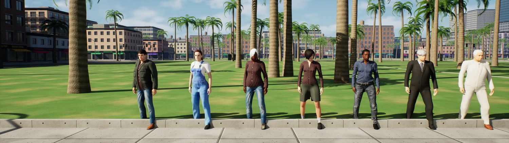
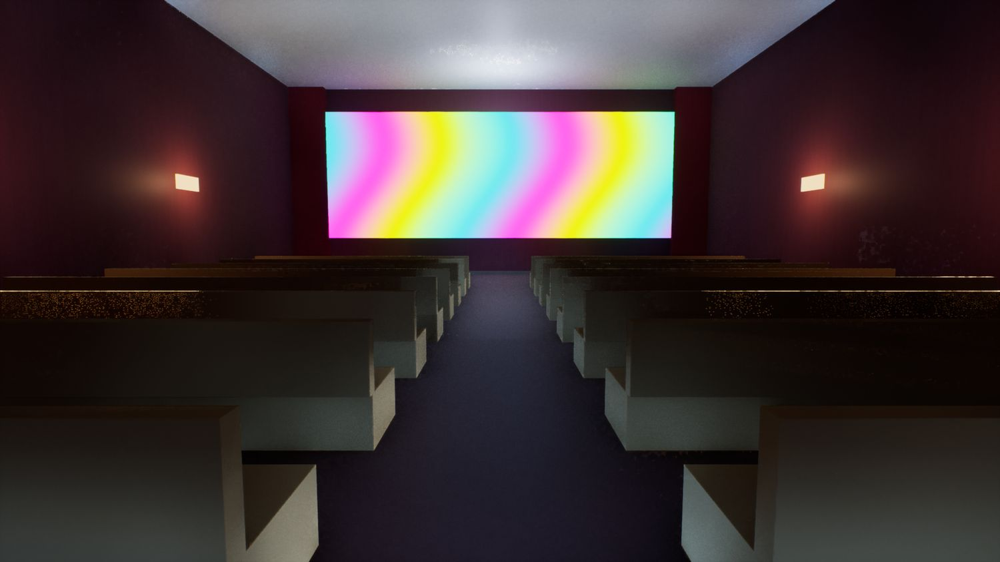

# Palmera Bay

Un jeu en monde ouvert original fait avec **Unreal Engine 5.8** : une ville côtière imaginaire au coucher du soleil, une histoire en 10 parties, des personnages réalistes et des voitures à conduire. Sans armes ni sang : poursuites, filatures, courses et enquête.

## Jouer

1. Va dans les [versions publiées](https://github.com/Minecraft-2048/palmera-bay/releases/latest) et télécharge `PalmeraBay-Windows.zip`.
2. Décompresse le dossier, puis lance `PalmeraBay.exe`.

Il faut Windows 10 ou 11 et une carte graphique avec le lancer de rayons (testé sur une RTX 4070 portable). Le premier lancement est plus lent, le temps de préparer les shaders. L'exe n'est pas signé, Windows peut donc demander une confirmation la première fois.

Le choix des graphismes (Bas, Moyen, Élevé, Épique) se trouve dans le menu, avec Échap.

Le dossier contient aussi **Palmera Racing** : un jeu de course avec les mêmes graphismes, à lancer avec `Palmera Racing.exe`. 4 circuits dans les rues de la ville, 5 pilotes à battre, de 1 à 9 tours, et un record par circuit.

## L'histoire

Six ans après avoir quitté Palmera Bay, Sam revient pour l'enterrement de Marius, le père de Nina. La police parle d'un accident. Nina n'y croit pas : le gang des Murènes rôde autour de son garage, pour le compte d'un promoteur qui veut raser le front de mer.

Un prologue et 9 chapitres : filatures, course de nuit, infiltration, des choix qui comptent et 3 fins. Les dialogues sont entièrement doublés en français, et 20 cassettes à trouver en ville racontent le passé.

Huit bâtiments s'ouvrent quand on appuie sur E devant leur porte : cinéma, salle d'arcade, pizzeria, musée, salle de sport, mairie, hôtel et bibliothèque. On y croise des habitants qui en savent long sur la ville.

## Commandes

| Touche | Action |
|---|---|
| Z Q S D ou flèches | se déplacer, conduire |
| Souris | regarder autour de soi, à 360° en voiture |
| V | replacer la caméra derrière la voiture |
| Maj | courir |
| Espace | sauter, frein à main pour déraper |
| F | monter dans une voiture ou en descendre |
| E | parler, fouiller, réparer, repeindre |
| Entrée | passer une réplique |
| H, C, L, R | klaxon, radio, phares, remettre la voiture sur ses roues |
| M | carte |
| Échap | menu, graphismes, journal, sauvegarde |

La manette est aussi prise en charge.

## Comment c'est fait

Tout le monde est bâti au lancement par du code C++ à partir de pièces générées par des scripts Python : immeubles, routes, enseignes, voitures, textures, sons et musiques de radio. Seule l'histoire est écrite à la main, dans `Content/Histoire/histoire.json`.

| Dossier | Contenu |
|---|---|
| `Source/PalmeraBay` | le code du jeu : ville, voitures, police, passants, histoire, interface |
| `Content/Histoire` | le scénario, les personnages et les textes |
| `Outils/art` | génération des textures, modèles et sons |
| `Outils/python` | construction des matériaux dans Unreal |
| `Outils/humains` | création des personnages avec MakeHuman et ajustement sur le squelette du jeu |

Le contenu Unreal n'est pas dans ce dépôt : les fichiers générés sont très lourds, et les modèles fournis par Epic n'ont pas le droit d'être redistribués sous cette forme. Pour reconstruire le projet, il faut donc Unreal Engine 5.8, Visual Studio 2022, Blender et le contenu des gabarits Epic, puis lancer les scripts d'`Outils`.

## Licences

- Le code et les scripts de ce dépôt sont sous licence [MIT](LICENSE).
- Les personnages sont créés avec [MakeHuman](http://www.makehumancommunity.org/) (extension MPFB pour Blender) et son pack d'assets libres CC0.
- Unreal® Engine, Copyright 1998-2026, Epic Games, Inc. Tous droits réservés. Unreal® est une marque d'Epic Games, Inc. Le jeu publié inclut le mannequin et les véhicules de démonstration d'Epic, selon la licence d'Unreal Engine.
- Les voix sont synthétisées avec les voix françaises de Windows.
